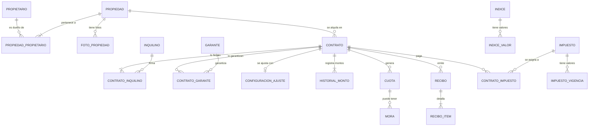
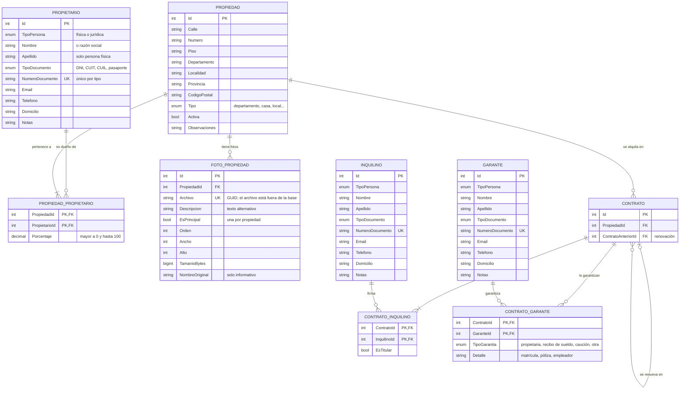
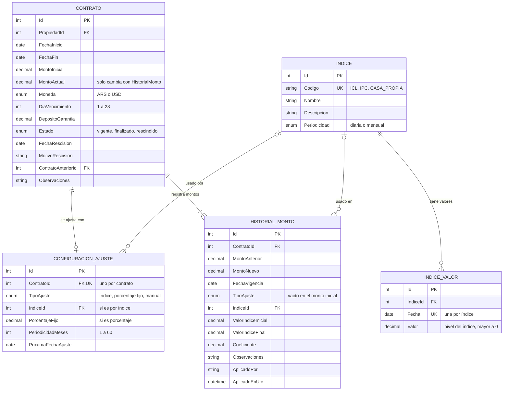
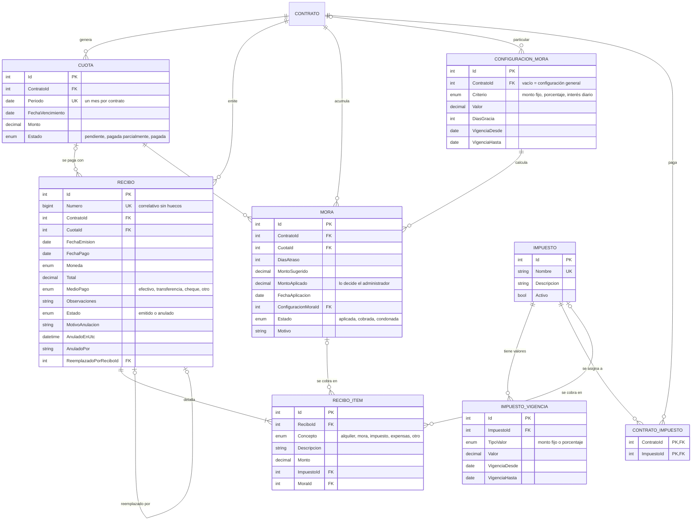
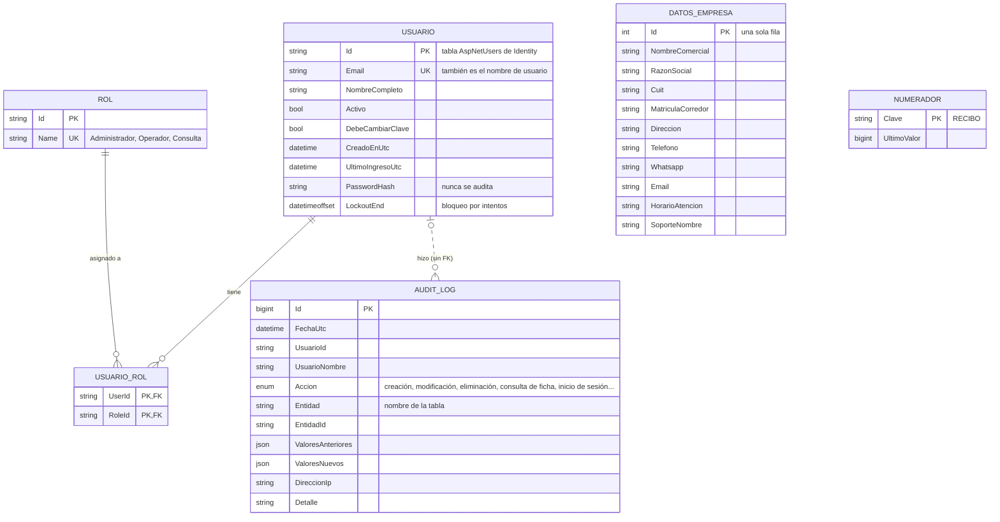

# Diagrama entidad-relación (DER)

Modelo de datos de Gestión de Alquileres, tomado del código (`Models/Entidades` y `Data/Configurations`).
Los diagramas están en [Mermaid](https://mermaid.js.org/): se ven dibujados en GitHub y en VS Code con la
extensión "Markdown Preview Mermaid Support". También se pueden pegar en <https://mermaid.live>.

> Mantenerlo actualizado: cada migración que cambie tablas o relaciones tiene que actualizar este archivo.

## Cómo leerlo

**Cardinalidad**

| Símbolo | Significa |
|---|---|
| `\|\|` | exactamente uno |
| `o\|` | cero o uno |
| `\|{` | uno o muchos |
| `o{` | cero o muchos |

- La línea punteada indica una relación lógica sin clave foránea.
- **PK** = clave primaria, **FK** = clave foránea, **UK** = valor único.

**Campos comunes que no se repiten en los diagramas**

| Tipo de tabla | Campos | Tablas |
|---|---|---|
| Auditable | `Id`, `CreadoEnUtc`, `CreadoPor`, `ModificadoEnUtc`, `ModificadoPor`, `RowVersion` (concurrencia) | `ConfiguracionAjuste`, `Recibo`, `DatosEmpresa` |
| De negocio | Lo anterior, más `Eliminado`, `EliminadoEnUtc`, `EliminadoPor` (borrado lógico) | `Propietario`, `Inquilino`, `Garante`, `Propiedad`, `FotoPropiedad`, `Contrato`, `Indice`, `IndiceValor`, `Cuota`, `Mora`, `ConfiguracionMora`, `Impuesto`, `ImpuestoVigencia` |
| Solo agregar | No se modifican ni se eliminan | `HistorialMonto`, `ReciboItem`, `AuditLog` |

**Reglas que no se ven en el dibujo**
- Los índices únicos de documento, código y nombre ignoran los registros eliminados.
- Todas las claves foráneas propias son `Restrict`: nada se borra en cascada.
- `Contrato.MontoActual` cambia solo junto con una fila nueva de `HistorialMonto`.
- El estado de la propiedad (alquilada o disponible) no se guarda: se calcula a partir de los contratos vigentes.

## 1. Vista general

## 2. Personas y propiedades

Copropietarios (N:M, con porcentaje que suma 100), coinquilinos (N:M, con un titular) y garantes por contrato
(N:M, con el tipo de garantía en la relación: la misma persona puede garantizar distintos contratos de
distinta forma).

## 3. Contratos y ajustes de precio

El nivel de cada índice se guarda por fecha. Así el ajuste es un cociente de valores y queda trazado en el historial.

## 4. Cobranza, mora e impuestos

Cuotas (lo que se debe), recibos (lo que se pagó, con pagos parciales), mora aplicada manualmente sobre
una cuota e impuestos con vigencia que se suman como ítems del recibo.

## 5. Tablas de soporte

No se relacionan por clave foránea con el resto: los registros de auditoría guardan el tipo y el Id del
registro como texto, para no impedir nunca un cambio.

